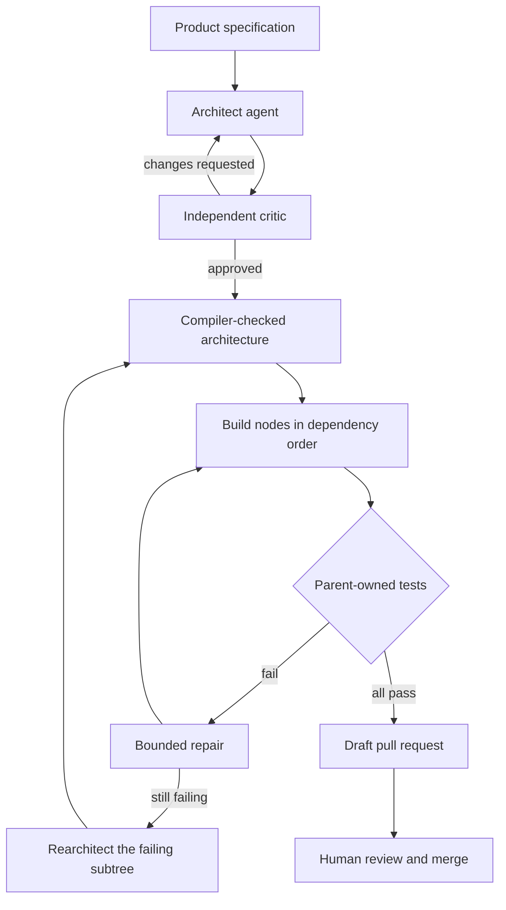

# Foundry

**Governance for AI software builds.** Foundry turns a product specification into a checked architecture, has scoped AI agents build it piece by piece, and delivers the result as a draft pull request for a human to review.

A coding agent produces code. Foundry manages the organization around it: who owns each part, who verifies it, what happens when it fails, and what evidence remains afterward. It is built for projects too large, long-running, or risky to trust to one model session. [Why Foundry](docs/why-foundry.md) explains the reasoning.

> [!NOTE]
> Foundry is experimental, pre-release software. Some capabilities are still in progress, so you build it from source. The [roadmap](docs/roadmap.md) is the authoritative status for each one.

## How it works



An architecture is a JSON document called the IR (intermediate representation). Its compiler rejects unsafe paths, cycles, and invalid ownership before any agent writes code. Each node pairs a *doer*, which implements the node, with an independent *tester*, which verifies it. This abridged node comes from [`string-utils.ir.json`](ir/examples/string-utils.ir.json):

```json
{
  "id": "hyphenate",
  "kind": "leaf",
  "owner": "string-utils",
  "implementation": {
    "language": "python",
    "write_target": "src/hyphenate.py"
  },
  "acceptance": {
    "mandate_owner": "string-utils",
    "cases": [
      { "name": "collapse", "call": "hyphenate('a   b')", "expect": "a-b" }
    ]
  }
}
```

The doer can write only to `src/hyphenate.py`, and the node's owner sets its tests, so an agent can't rewrite its own exam.

## Features

- **Contract-driven architecture:** define ownership, interfaces, dependencies, write scopes, and acceptance tests in a validated document.
- **Independent review:** architect and critic run as separate identities, and an author can't approve its own draft.
- **Scoped workers:** each worker runs in an OS sandbox, with write access limited to its declared target.
- **Durable builds:** builds, retries, artifacts, and decisions survive crashes and restarts without repeating finished work.
- **Scoped rearchitecture:** replace a persistently failing subtree while keeping its external interface and unaffected siblings intact.
- **Polyglot builds:** build nodes in Python, TypeScript, and Go.
- **Managed dependencies and resources:** IR v2 declares packages, PostgreSQL, Redis, S3, and third-party integrations, tested in private Docker environments.
- **Human-reviewed delivery:** Foundry only publishes draft pull requests. It has no approve, merge, or force-push path.
- **Agent access:** use Foundry from Claude Code or Codex through its [MCP server](#use-foundry-from-an-ai-coding-tool).

## Quick start

This quick start runs a complete durable build with prewritten code standing in for the LLM, so you don't need an API key.

### Prerequisites

| Tool | Needed for |
|---|---|
| [Rust](https://rustup.rs) (stable) | Building the control-plane host |
| [Node.js](https://nodejs.org) 26 | Running the worker pool and MCP server |
| Python 3 | Running the example's tests |
| macOS | This quick start's sandbox (Seatbelt) |
| [Docker](https://docs.docker.com/get-docker/) (optional) | Linux isolation and IR v2 builds |

On Linux, workers use rootless OCI containers instead of Seatbelt. See [Run with a real LLM](docs/M5-activation.md).

### Build

```sh
git clone https://github.com/Bukola-Oludiran/Foundry.git
cd Foundry
make install
cargo build --manifest-path gr-host/Cargo.toml --locked
export PATH="$PWD/gr-host/target/debug:$PATH"
```

### Check an architecture

Validate the example, then print its build plan:

```sh
foundry-host validate --ir ir/examples/string-utils.ir.json
foundry-host build --ir ir/examples/string-utils.ir.json --dry-run
```

```text
valid IR v1: lowercase → trim → hyphenate → string-utils
Foundry dry-run: string-utils
  generation 0: lowercase, trim, hyphenate
  generation 1: string-utils
```

Nodes in the same generation have no dependencies on each other. `string-utils` waits for the three below it.

### Run a durable build

Create a target repository, start a worker, and run the build:

```sh
export FOUNDRY_WORKSPACE_ROOT="$(mktemp -d)"
git -C "$FOUNDRY_WORKSPACE_ROOT" init -q -b main
git -C "$FOUNDRY_WORKSPACE_ROOT" -c user.name=demo -c user.email=demo@example.invalid \
  commit -q --allow-empty -m base
BASE="$(git -C "$FOUNDRY_WORKSPACE_ROOT" rev-parse HEAD)"

export FOUNDRY_WORKER_TOKEN="local-demo-token-at-least-32-characters"
export FOUNDRY_WORKER_STATE_DIR="$FOUNDRY_WORKSPACE_ROOT/.foundry/worker-state"
export FOUNDRY_ALLOW_LOCAL_TESTER=1
export FOUNDRY_STUB_IMPLS="$PWD/pi-pool/fixtures/string-utils-impls.mjs"

PORT=8811 node pi-pool/src/server.ts &
WORKER=$!
sleep 3

build() {
  foundry-host --ir ir/examples/string-utils.ir.json \
    --pi-pool http://127.0.0.1:8811 \
    --workspace "$FOUNDRY_WORKSPACE_ROOT" --base "$BASE" \
    --durability local --durability-dir "$FOUNDRY_WORKSPACE_ROOT/.foundry/durable"
}

build
```

The build ends with:

```text
✅ durable build: ALL GREEN
```

`FOUNDRY_ALLOW_LOCAL_TESTER` and the prewritten code are for this demo only. To use a real model and the Piston test runner, follow [Run with a real LLM](docs/M5-activation.md).

### Recover the finished run

Stop the worker and run the same build again:

```sh
kill "$WORKER"
build
```

Foundry finds the completed run in its durable log, so it finishes without calling the worker:

```text
  recovery: 1 records, 0 pending messages
  durable run: <run-id> (Succeeded)
```

### Watch the safeguards work

These checks need no worker. The first shows a sandboxed write being blocked outside its scope. The second injects a buggy `hyphenate` and shows the failure reaching only that node and its integrator:

```sh
npm run --prefix pi-pool validate:sandbox
npm run --prefix pi-pool validate:build
```

```text
  RED   string-utils   (as expected)
  GREEN lowercase      (as expected)
  GREEN trim           (as expected)
  RED   hyphenate      (as expected)
```

## Command reference

`foundry-host` covers the full lifecycle:

| Command | Purpose |
|---|---|
| `validate` | Check an IR document with the compiler |
| `architect` | Generate IR from a specification, using a configured model |
| `foundry-host --ir ...` or `build` | Build an architecture, or plan one with `--dry-run` |
| `status` | Read a durable run's state |
| `cancel` | Request durable cancellation of a run |
| `rearchitect` | Check a proposed subtree replacement, and optionally run it |
| `publish` | Publish a green run as a draft pull request |
| `deps`, `resources` | Resolve dependencies and plan environments for IR v2 |

## Use Foundry from an AI coding tool

Foundry's MCP server exposes 11 tools for validation, architect-critic review, builds, status, cancellation, rearchitecture, and publication. Tools accept only configured workspace IDs and relative paths, and credentials are never tool arguments.

Build the host as shown above, then install the server's dependencies:

```sh
npm ci
```

- **Claude Code:** the repository includes a project-scoped `.mcp.json`. Run `claude` in the repository and approve the server on first use. See the [Claude Code guide](docs/claude-code.md).
- **Codex:** the repo-local plugin and workflow skills are in [`plugins/foundry`](plugins/foundry).
- **Other MCP clients:** set a workspace, then start the stdio server:

  ```sh
  export FOUNDRY_WORKSPACE_ROOTS="foundry=$PWD"
  npm run mcp:stdio
  ```

## Architecture

Foundry has two planes:

- **Control plane ([`gr-host`](gr-host)):** a Rust host built on [GraphReact](https://github.com/Bukola-Oludiran/GraphReact). It handles the compiler, ownership tree, supervision, durable state, and publication.
- **Worker plane ([`pi-pool`](pi-pool)):** Node.js workers that make LLM calls through `pi-ai`, write code inside a sandbox, and run tests through [Piston](https://github.com/engineer-man/piston) or isolated containers.

| Path | Contents |
|---|---|
| [`ir/`](ir/README.md) | IR schemas, rules, and examples. Start here to understand the model. |
| [`gr-host/`](gr-host) | Rust compiler and control-plane host |
| [`pi-pool/`](pi-pool) | Worker pool, sandboxing, and runtime images |
| [`src/`](src) | MCP server |
| [`plugins/foundry/`](plugins/foundry) | Codex plugin and workflow skills |
| [`examples/`](examples) | Larger architecture exercises, including a [16-node supply-chain system](examples/aegis-supply-chain/README.md) |
| [`docs/`](docs) | Contracts, operations guides, and decision records |

## Known limitations

- **Sandboxing:** Seatbelt on macOS is a development backend. Use rootless OCI containers on Linux for production-grade isolation.
- **Crash recovery:** interrupting a synchronous runner process and making Git operations durable effects are still in progress.
- **Architecture Studio:** this collaborative editing service is an editable preview, and its desktop interface lives in the separate Buzz project.
- **Languages:** only Python, TypeScript, and Go are supported.
- **Hosting:** multi-tenancy, quotas, billing, fleet scheduling, and Postgres/S3 failover are deferred.

## Documentation

- [Why Foundry](docs/why-foundry.md): the product rationale and intended lifecycle
- [Roadmap](docs/roadmap.md): implementation status and acceptance gates
- [IR guide](ir/README.md): the architecture format and compiler rules
- [Run with a real LLM](docs/M5-activation.md): provider, Piston, and sandbox setup
- [Runtime services](docs/runtime-services.md): Docker services for IR v2 builds
- [Worker contract](docs/contract.md): the protocol between host and workers
- [Architecture Studio operations](docs/architecture-studio-operations.md): running the Studio service
- [Decision records](docs/adr): the reasoning behind major choices

## Development

`make check` runs formatting, linting, and the tests that need no external services:

```sh
make check
```

`make test-local` adds the sandbox and live worker checks. `make test-live-polyglot` runs the full Python, TypeScript, and Go acceptance test and requires Docker.
